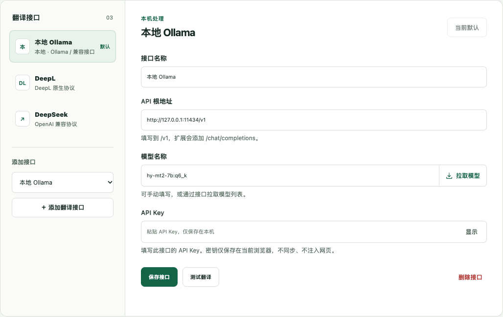

<p align="center">
  
</p>

<h1 align="center">译流 · Flow Translate</h1>

<p align="center">网页原位翻译，Discord 会话翻译。连接本地模型，也能选择云端接口。</p>

<p align="center">
  
  
  
  
</p>

<p align="center">
  <a href="#功能">功能</a> ·
  <a href="#安装">安装</a> ·
  <a href="#快速上手">快速上手</a> ·
  <a href="#支持的接口">支持的接口</a> ·
  <a href="docs/usage.md">使用指南</a> ·
  <a href="CHANGELOG.md">更新记录</a>
</p>

<p align="center">
  项目仓库：<a href="https://github.com/hi-yu/flow-translate">GitHub</a> ·
  <a href="https://cnb.cool/root/flow-translate">CNB</a>
</p>

## 功能

| 场景         | 可以做什么                                                        |
| ------------ | ----------------------------------------------------------------- |
| 网页翻译     | 在原位置显示译文，保留页面结构、链接和控件，随时切回原文          |
| 网站自动翻译 | 按域名记住偏好，下次访问自动翻译；支持添加、编辑和取消            |
| Discord 阅读 | 单条翻译或按频道自动翻译，支持双语对照与仅显示译文                |
| Discord 发送 | 翻译输入框草稿，预览后替换或复制；右键切换目标语言                |
| 多接口切换   | 支持本地 Ollama、DeepL、DeepSeek、通义、Gemini 和 OpenAI 兼容接口 |
| 模型选择     | 从接口拉取模型列表并下拉选择，也可手动填写模型 ID                 |
| 多语言处理   | 原文自动识别，英语优先，也支持日语、韩语、俄语等语言              |

支持流式显示与会话缓存。翻译内容只发送给当前选择的接口，不会自动切换到其他服务商。

## 界面预览



接口配置由网页与 Discord 共用，下方的「普通网页 / Discord」标签分别管理网站和频道偏好。截图使用示例配置。

## 安装

支持 **Chrome 120 及以上版本**，通过「加载已解压的扩展程序」安装。

### 使用安装包

在 [GitHub Releases](https://github.com/hi-yu/flow-translate/releases) 或 [CNB Releases](https://cnb.cool/root/flow-translate/-/releases) 下载。正式版本提供 ZIP 与 CRX，main 构建版提供 ZIP。

1. 解压 `flow-translate-0.1.0-chrome.zip`。
2. 打开 `chrome://extensions`，开启右上角「开发者模式」。
3. 点击「加载已解压的扩展程序」，选择解压后含 `manifest.json` 的文件夹。
4. 将「译流」固定到工具栏，打开「设置」配置翻译接口。

ZIP 是解压安装包，不能直接作为 CRX 安装。当前尚未提供 Chrome 商店安装入口。

### 从源码构建

需要 **Node.js 20.19+** 和 npm。在项目根目录执行：

```sh
npm ci
npm run build
```

然后按上述 Chrome 安装步骤，选择项目中的 **`dist/`** 文件夹。

更新时重新构建或替换解压目录，在扩展管理页点击「重新加载」，再刷新已打开的网页。已有接口、密钥和偏好保留。

## 快速上手

1. **配置接口**：打开设置，在左侧选择预设并添加接口，填写 API 根地址和 API Key。
2. **选择模型**：点击「拉取模型」获取下拉列表，或手动填写模型 ID；DeepL 无需模型。
3. **保存并测试**：点击「保存接口」，允许对应接口的访问权限，再点击「测试翻译」。
4. **开始翻译**：打开网页，点击扩展图标 →「翻译此网页」；Discord 可直接点击消息下方的「翻译」。

本地预设为 `http://127.0.0.1:11434/v1`，模型为 `hy-mt2-7b:q6_k`。使用前需自行准备可用的 Ollama 鉴权网关；扩展本身不安装或启动模型服务。其他电脑请按实际服务填写地址、密钥和模型。

## 支持的接口

| 服务              | API 根地址示例                                      | 模型配置              |
| ----------------- | --------------------------------------------------- | --------------------- |
| 本地 Ollama 网关  | `http://127.0.0.1:11434/v1`                         | 已安装的模型 ID       |
| DeepSeek          | `https://api.deepseek.com/v1`                       | 如 `deepseek-chat`    |
| 通义千问          | `https://dashscope.aliyuncs.com/compatible-mode/v1` | 如 `qwen-plus`        |
| OpenAI / 兼容服务 | `https://api.openai.com/v1` 或服务商地址            | 账户可用的模型 ID     |
| DeepL             | 免费版 / 付费版 / 自定义下拉选择                    | 无需填写              |
| Google Gemini     | `https://generativelanguage.googleapis.com/v1beta`  | 账户可用的生成模型 ID |

服务预设决定请求协议：DeepL、Gemini 使用各自原生接口，其余使用 OpenAI 兼容接口。模型列表获取失败时可继续手动填写；「拉取模型」仅获取模型列表，不下载模型文件，也不自动保存配置。

DeepL 的免费版地址为 `https://api-free.deepl.com/v2`，付费版为 `https://api.deepl.com/v2`。请在 [DeepL 密钥管理页面](https://www.deepl.com/zh/your-account/keys) 获取对应版本的 API Key。

远程接口需使用 HTTPS；仅本机回环地址允许 HTTP。模型可用性、额度与费用以服务商账户为准。

## 使用方式

### 普通网页

- 点击「翻译此网页」在原位置显示译文，滚动时继续处理可见内容；点击「显示原文」恢复。
- 开启「自动翻译此域名」，下次访问时自动翻译。也可在设置 →「普通网页」管理常用网站。
- 选中文字后右键，选择「用译流翻译选中文字」，只翻译选中部分。

### Discord

- **阅读消息**：点击消息下方的翻译按钮；译文不满意时可为该条消息切换接口。
- **自动翻译**：在扩展弹窗开启「此频道自动翻译」；设置 →「Discord」可查看和关闭已启用的频道。
- **显示方式**：在设置中选择「双语对照」或「仅显示译文」。
- **发送前翻译**：点击输入框右侧的「翻译成英语」，预览后替换草稿或复制；右键按钮更换语言。消息仍由你手动发送。

支持 `discord.com`、`ptb.discord.com`、`canary.discord.com` 的网页版频道与私信。发送目标语言与阅读目标语言分别保存。

| 快捷键            | 操作                    |
| ----------------- | ----------------------- |
| `Alt + Shift + T` | 翻译当前网页 / 可见消息 |
| `Alt + Shift + R` | 恢复原文 / 移除消息译文 |

可在 `chrome://extensions/shortcuts` 自定义快捷键。域名规则、草稿保护和更多操作见[完整使用指南](docs/usage.md)。

## 隐私与权限

- **按选择发送**：使用本地接口时内容发送给本地服务；使用云端接口时内容发送给对应服务商，无遥测或自动云端回退。
- **密钥留在浏览器**：API Key 保存在当前 Chrome 的本地扩展存储，不参与同步，不注入网页；该存储不等同于系统钥匙串。
- **权限按需授予**：手动网页翻译使用当前标签页权限；自动翻译单独申请相应域名的访问权限。
- **草稿由你控制**：仅在主动点击翻译后读取 Discord 草稿，不读取账号令牌，不调用 Discord 私有 API，不自动发送消息。
- **缓存随会话保留**：译文缓存使用浏览器会话存储，可在设置中清除，浏览器重启或扩展重新加载后清空。

## 常见问题

| 情况                    | 处理方式                                                        |
| ----------------------- | --------------------------------------------------------------- |
| 提示没有拉取到模型      | 检查地址、API Key 与权限；服务不支持模型列表时手动填写模型 ID   |
| 返回 HTTP 401 / 403     | 检查密钥、账户权限，以及 DeepL 免费版 / 付费版是否匹配          |
| 本地接口连接失败        | 确认模型服务与鉴权网关正在运行，并检查配置的地址和端口          |
| 更新后 Discord 按钮异常 | 重新加载扩展并刷新 Discord；仅保留一份启用的译流扩展            |
| 某些内容没有翻译        | Chrome 内部页、PDF、图片文字、iframe 与 Shadow DOM 正文暂不支持 |

网页按文字节点翻译，复杂页面和被内联元素拆开的句子可能影响译文连贯性。Discord 桌面客户端不在支持范围内。

## 开发

```sh
npm ci
npm run format:check
npm run check
npx playwright install chromium
npm run test:e2e
npm run package
```

`npm run check` 包含 TypeScript 检查、单元测试与构建；`npm run package` 生成 `dist/` 和 `releases/` 中的 ZIP。运行时无第三方依赖，不加载远程脚本。

项目通过 CNB 流水线检查和打包，成功后同步代码到 GitHub。在已同步的 main 分支执行 `npm run release`，CNB 将自动构建 ZIP、签名 CRX 和校验文件，并依次上传 CNB 与 GitHub Release。

项目结构、可选的本机 / AWS 集成验证及贡献说明见[开发指南](docs/development.md)。

## 文档

- [使用指南](docs/usage.md)：网页、Discord、模型列表和偏好设置。
- [开发指南](docs/development.md)：环境、构建、测试、项目结构与问题反馈。
- [验证记录](VALIDATION.md)：已执行的检查及验证边界。
- [更新记录](CHANGELOG.md)：各版本的功能和修复。
